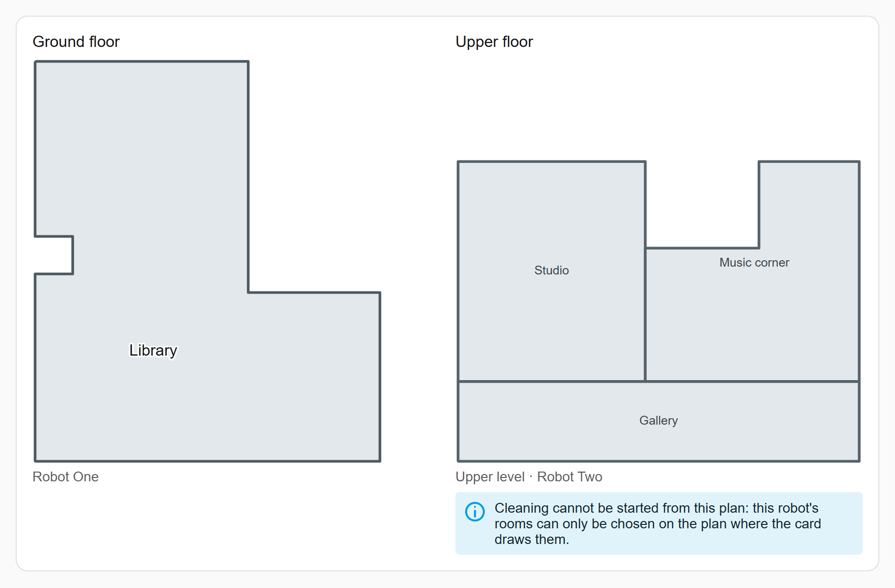

# Vacuum Map Card

Une carte de tableau de bord Home Assistant pour nettoyer n'importe quelle pièce de la maison avec n'importe lequel de vos robots : tous vos plans côte à côte, touchez une pièce, choisissez un robot, confirmez, c'est parti.

> **État : en développement.** La version 0.1.0 est un aperçu : elle s'installe depuis le Marketplace et n'affiche que son titre. Les plans, les pièces et les robots arrivent dans les prochaines versions.

[Read in English](README.md)

<picture>
  <source media="(prefers-color-scheme: dark)" srcset="./docs/images/card-dark.png">
  
</picture>

*La carte pour l'instant : seulement son titre. Les plans et les pièces arrivent ensuite.*

## Pourquoi

Les cartes d'aspirateur montrent en général un robot sur un plan. Une maison a souvent plusieurs étages et plusieurs robots (un aspirateur et un laveur, un robot par étage). Cette carte part de la maison plutôt que du robot :

- **Tous les étages d'un coup.** Un plan par étage, côte à côte, dans l'ordre des étages de Home Assistant.
- **Touchez une pièce, choisissez un robot.** La carte liste les robots capables de nettoyer cette pièce à côté d'elle (en bas de l'écran sur un téléphone), chacun avec ce qu'il ferait et son état, et dit pourquoi un robot ne peut pas démarrer ; Échap, un appui en dehors de la liste ou son bouton Fermer la ferment ; vous en choisissez un et confirmez : « Envoyer Roomba S9+ aspirer la chambre ? »
- **Aucune coordonnée à entretenir.** Pièces, contours et étages viennent de vos intégrations et de Home Assistant. Refaites la carte d'un étage dans l'application du fabricant, ajoutez une pièce ou un étage : la carte suit.
- **L'allure de Home Assistant.** Couleurs de votre thème en mode clair et sombre, utilisable au clavier et avec un lecteur d'écran : Tab atteint un plan, Gauche et Droite parcourent ses pièces dans l'ordre de lecture, Haut et Bas vont à la pièce la plus proche dans ce sens, Début et Fin vont à la première et à la dernière pièce, Entrée ou Espace en choisit une. Une pièce trop petite pour un doigt se touche juste à côté de son nom.

## Fonctionnement

1. **Les étages et les pièces** viennent de Home Assistant : étages et pièces, et l'association entre les segments de l'aspirateur et vos pièces (réglages de l'entité aspirateur, disponibles depuis Home Assistant 2026.3).
2. **Les contours des pièces** viennent d'un *adaptateur de source de pièces* propre à l'intégration de l'aspirateur. Le premier prend en charge [Roomba+](https://github.com/johnnyh1975/ha_roomba_plus) (iRobot). D'autres adaptateurs peuvent s'ajouter sans toucher au reste de la carte. La carte dessine elle-même les contours et les noms des pièces sur l'image de la carte des pièces : laissez l'option Roomba+ « Draw room names on the map image » désactivée (son réglage par défaut) : activée, chaque nom s'affiche deux fois ; les pièces qu'elle ne peut pas dessiner sont listées sous le plan.
3. **Le nettoyage** passe par l'action `vacuum.clean_area` de Home Assistant quand la pièce est associée à une pièce Home Assistant, sinon par l'action de l'intégration.

## Quand un étage ou une pièce manque

La carte indique sur le plan ce qui manque et ce que vous pouvez changer dans Home Assistant :

- **« Ce plan est désactivé dans Home Assistant »** : Roomba+ crée ses entités de plan désactivées. Pour en activer une, dans Paramètres › Appareils et services › Entités, réglez le filtre État sur Désactivée, recherchez l'entité du plan et ouvrez-la, ouvrez ses Paramètres, puis choisissez Activer sous « Cette entité est désactivée. ». Les administrateurs ont un bouton « Ouvrir les paramètres de l'entité » qui ouvre directement ces paramètres ; la carte elle-même ne les modifie jamais.
- **Un plan est sous « Plans sans étage »** : associez l'entité du plan à une pièce située sur un étage, attribuez un étage à cette pièce, ou ajoutez le nom du plan comme alias d'un étage. Un plan désactivé doit aussi être activé pour afficher son image.
- **Un plan affiche son image mais aucune pièce** : le robot n'a pas le nettoyage par pièce (un robot laveur, par exemple), donc ses pièces ne se choisissent que sur le plan où la carte les dessine ; ou ses segments ne sont pas encore associés aux pièces. Un administrateur les associe dans les paramètres de l'entité de l'aspirateur, qu'ouvre le bouton « Ouvrir les paramètres de l'aspirateur » de la carte ; les autres utilisateurs sont invités à le demander à un administrateur.
- **« pas encore de contours de pièces »** sous les plans : le plan des pièces du robot n'a pas de contours (aucun plan cloud chargé), ou le robot n'a pas d'entité de plan des pièces (absente ou désactivée). **« les contours des pièces n'ont pas pu être lus »** est suivi d'un code court à citer dans un rapport de bug.

## Intégrations prises en charge

| Intégration | Contours des pièces | Plans d'étage | Lancer une pièce | État |
|---|---|---|---|---|
| Roomba+ (iRobot) | Oui, carte active | Oui, toutes les cartes | Oui | Prévue |
| Autres | Contributions bienvenues, voir `CONTRIBUTING.md` | | | |

## Installation

La carte n'est pas encore dans le catalogue du Marketplace. Ajoutez-la comme dépôt personnalisé :

1. Dans Home Assistant, ouvrez **Paramètres > Marketplace > Ajouter grâce à un lien**.
2. Saisissez `EnO33/vacuum-map-card` et choisissez le type **Tableau de bord** si la question est posée.
3. Installez le dépôt et rechargez la page du navigateur.
4. Sur un tableau de bord, ajoutez une carte **Manuel** avec `type: custom:vacuum-map-card`.

Le Marketplace crée aussi une entité de mise à jour nommée « Vacuum Map Card ». Une tuile qui affiche « À jour » sous ce nom est cette entité, pas la carte.

## Configuration

```yaml
type: custom:vacuum-map-card
```

La carte n'a encore aucune option. Options prévues (cible, pas définitive, ignorées par la 0.1.0) :

```yaml
# Tout sera découvert par défaut : étages, pièces, robots.
# Réglages facultatifs :
floors: [ground_floor, first_floor]   # identifiants d'étages Home Assistant, dans l'ordre d'affichage
robots: [vacuum.my_vacuum, vacuum.my_mop]
```

Un éditeur visuel est prévu.

## Prérequis

- Home Assistant 2026.3.0 ou plus récent pour la carte elle-même, par exemple avec une ressource de tableau de bord ajoutée à la main.
- Home Assistant 2026.11 ou plus récent, pour l'installation depuis le Marketplace.
- Une intégration d'aspirateur prise en charge (voir plus haut).

## Contribuer

Issues et pull requests bienvenues. Lisez d'abord [CONTRIBUTING.md](CONTRIBUTING.md), en particulier la partie sur l'ajout d'une intégration.

## Licence

[MIT](LICENSE).
