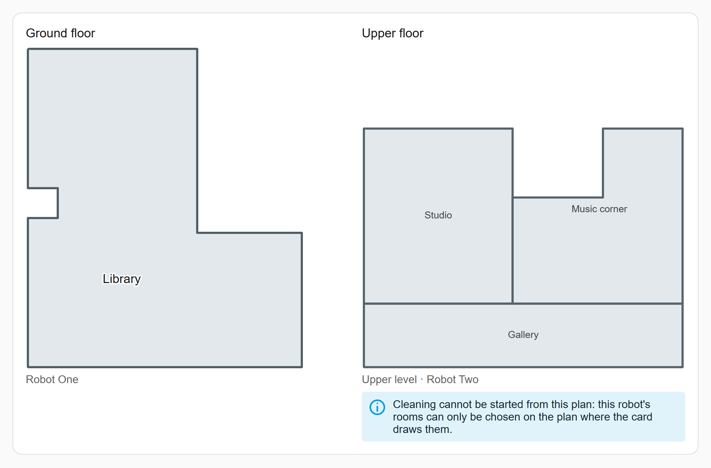

# Vacuum Map Card

A Home Assistant dashboard card to clean any room of your home with any of your robots: all your floor plans side by side, tap a room, pick a robot, confirm, done.

> **Status: early development.** Version 0.1.0 is a preview: it installs from the Marketplace and shows only its title. Floor plans, rooms and robots come in later versions.

[Lire en français](README.fr.md)

<picture>
  <source media="(prefers-color-scheme: dark)" srcset="./docs/images/card-dark.png">
  
</picture>

*The card today: only its title. Floor plans and rooms come next.*

## Why

Vacuum map cards usually show one robot on one map. Homes have several floors and often several robots (a vacuum and a mop, one robot per floor). This card starts from your home instead of from a robot:

- **Every floor at once.** One plan per floor, side by side, in your Home Assistant floor order.
- **Tap a room, pick a robot.** The card lists the robots able to clean that room; you choose one and confirm: « Send Roomba S9+ to vacuum the bedroom? »
- **No coordinates to maintain.** Rooms, outlines and floors come from your integrations and from Home Assistant. Re-map a floor in the vendor app, add a room or a floor: the card follows.
- **Looks like Home Assistant.** Native components, your theme's colours in light and dark mode, keyboard and screen-reader friendly.

## How it works

1. **Floors and rooms** come from Home Assistant: floors and areas, and the mapping between your vacuum's segments and your areas (vacuum entity settings, available since Home Assistant 2026.3).
2. **Room outlines** come from a *room source* adapter for your vacuum integration. The first one supports [Roomba+](https://github.com/johnnyh1975/ha_roomba_plus) (iRobot). More adapters can be added without touching the rest of the card.
3. **Cleaning** uses Home Assistant's own `vacuum.clean_area` action when the room is mapped to an area, or the integration's room action otherwise.

## Supported integrations

| Integration | Room outlines | Floor plans | Start a room | Status |
|---|---|---|---|---|
| Roomba+ (iRobot) | Yes, active map | Yes, every stored map | Yes | Planned |
| Others | Contributions welcome, see `CONTRIBUTING.md` | | | |

## Installation

The card is not in the Marketplace catalog yet. Add it as a custom repository:

1. In Home Assistant, go to **Settings > Marketplace > Add from link**.
2. Enter `EnO33/vacuum-map-card` and choose the **Dashboard** type if asked.
3. Install the repository and reload the browser page.
4. On a dashboard, add a **Manual** card with `type: custom:vacuum-map-card`.

The Marketplace also creates an update entity named « Vacuum Map Card ». A tile showing « Up-to-date » under that name is the update entity, not the card.

## Configuration

```yaml
type: custom:vacuum-map-card
```

The card has no option yet. Planned options (target design, not final, ignored by 0.1.0):

```yaml
# Everything will be discovered by default: floors, rooms, robots.
# Optional overrides:
floors: [ground_floor, first_floor]   # Home Assistant floor ids, in display order
robots: [vacuum.my_vacuum, vacuum.my_mop]
```

A visual editor is planned.

## Requirements

- Home Assistant 2026.3.0 or later for the card itself, for example with a dashboard resource added by hand.
- Home Assistant 2026.11 or later, to install from the Marketplace.
- A supported vacuum integration (see above).

## Contributing

Issues and pull requests are welcome. Read [CONTRIBUTING.md](CONTRIBUTING.md) first, in particular the section on adding a new integration.

## Licence

[MIT](LICENSE).
